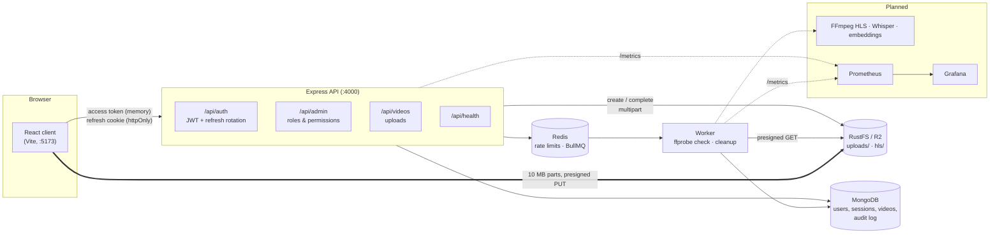
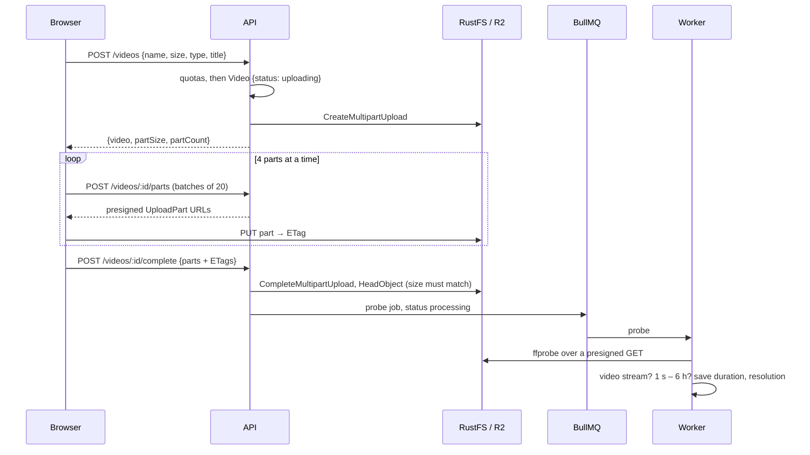
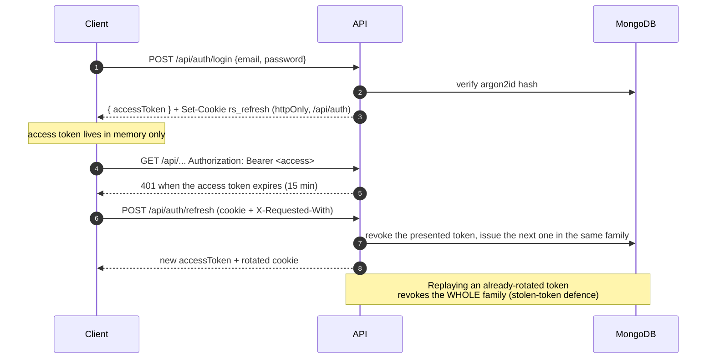

<div align="center">


### Ask any video. Jump straight to the answer.

A long-form video platform built with the MERN stack and TypeScript. It has adaptive HLS streaming, hardened JWT auth with refresh-token rotation, and **Ask the Video**: ask a question about a lecture or talk and get an answer that cites the exact second it was said.


</div>

---

## Contents
- [Features](#features)
- [Tech stack](#tech-stack)
- [Architecture](#architecture)
- [Auth flow](#auth-flow)
- [Getting started](#getting-started)
- [Local infrastructure (Docker)](#local-infrastructure-docker)
- [Environment variables](#environment-variables)
- [Scripts](#scripts)
- [API](#api)
- [Project layout](#project-layout)
- [Testing](#testing)
- [Roadmap](#roadmap)

---

## Features

### Built
- **JWT auth with refresh-token rotation:**
  - short-lived access token, kept in memory on the client
  - refresh token in an `httpOnly` cookie scoped to `/api/auth`
  - **reuse detection**: replaying a token that has already been rotated revokes the whole session family
- **Session management:** list every signed-in device, sign one out, or sign out everywhere.
- **Roles and permissions:** `user`, `moderator` and `admin`, with one permission map shared by the client and the server (`shared/src/permissions.ts`).
- **Rate limiting:**
  - per-IP and per-email limits on login, register, refresh and the username check
  - backed by **Redis**, with an automatic **MongoDB fallback** if Redis is down
- **Hardening:**
  - argon2id password hashing
  - Helmet security headers
  - a CSRF header check on cookie-authenticated routes
  - constant-time login (a dummy hash is checked when the user doesn't exist)
  - 100 KB JSON body limit
- **Three-step signup:**
  - **Account:** email, password with a strength meter, confirm password.
  - **Profile:** name, a unique `@username` with a live availability check, date of birth (13 or older).
  - **Interests:** pick topics and accept the terms.
  - Every rule is validated by the same zod schema on the client and the API.
- **Client UI:**
  - a cinematic home page with a featured "stage" and shelves
  - Explore, Subscriptions, History, Watch later, Liked and Library pages, plus channel pages
  - a ⌘K search / ask palette
  - a floating glass sidebar on desktop and a drawer on mobile
  - light and dark themes, responsive from 390px up
- **Watch page:**
  - a player with a console holding **Ask this video**, **Chapters** and **Transcript** tabs
  - clickable timestamp chips
- **Admin console** (`/admin`) for moderators and admins:
  - **Dashboard:** live user totals, a 30-day signup chart, role split, top interests, newest members, video count, storage used and pipeline failures
  - **Users:** search by name, email or @handle; filter by role and status; change roles; sign a user out of every device; suspend or unsuspend
  - **Audit log:** every admin action, who did it and when
  - **Videos:** every upload with owner, size, resolution and pipeline state; remove with a reason (the owner sees it), restore, re-run a failed file check, all audited
  - **Reports:** a moderation queue on demo data until comments exist
  - **After login, staff choose** between the admin console and the app (and can remember the choice)
- **Direct-to-storage video uploads:**
  - the browser splits the file into 10 MB parts and PUTs them **straight to S3-compatible storage** (RustFS locally, R2 in prod) with presigned URLs; video bytes never pass through the API
  - 4 parts in flight, per-part retry with backoff and a fresh URL, live MB/s and time left, cancel at any point (the multipart upload is aborted)
  - on completion the API checks the stored size against what the client claimed, then queues a job (a mismatch marks the video failed and deletes the file)
  - quotas: 5 GB per file, 3 uploads in progress and 10 a day per user
- **Background worker (BullMQ):** a separate process runs **ffprobe** on each upload over a presigned URL (no full download), rejects files that aren't real videos with a plain-language reason (playlist formats and non-HTTP protocols are blocked, so an upload can't make the worker fetch other URLs), retries when storage is down, records duration, resolution and codec, and sweeps uploads abandoned for 24 hours.
- **Your videos:** live status (Uploading → Checking file → Waiting to transcode), edit title, description and visibility, delete (removes the files from storage too).
- **Account suspension that takes effect immediately:** login, token refresh and every authenticated request refuse a suspended account, and all its sessions are revoked.
- **Health endpoint** reporting MongoDB and Redis status.

> The browse catalogue (home, explore, watch), transcripts and Ask answers still come from a typed placeholder data layer (`client/src/data/`) until uploaded videos can be played (Phase 3–4). Uploads, Your videos and the admin console use the real API.

### In progress / planned
- **FFmpeg** transcode in the worker: a 360p/720p/1080p HLS ladder plus a thumbnail
- **Groq Whisper** transcription, then embeddings, then **RAG with timestamp citations**
- **Prometheus + Grafana** monitoring with a provisioned dashboard
- GitHub Actions CI and a production deploy

See the [Roadmap](#roadmap) for details.

---

## Tech stack

| Layer | Tools |
|---|---|
| **Client** | React 19, Vite, TypeScript, Tailwind CSS v4, shadcn/ui (Radix), Motion, react-hook-form + zod, sonner, cmdk |
| **Server** | Node.js ≥ 24, Express 5, Mongoose, zod, argon2, jsonwebtoken, Helmet, express-rate-limit, pino |
| **Shared** | `@reelstack/shared`: zod schemas, DTO types, the permission map (one source of truth for both sides) |
| **Database** | MongoDB 8 |
| **Cache / limits / queue** | Redis 7 via ioredis (rate limits) and **BullMQ** (media jobs) |
| **Storage** | S3 API via `@aws-sdk/client-s3`: multipart uploads with presigned part URLs (RustFS locally, Cloudflare R2 in prod) |
| **Object storage** | RustFS locally (S3-compatible), Cloudflare R2 in production |
| **Media** | ffprobe file checks today; FFmpeg → adaptive HLS with hls.js next |
| **AI** *(planned)* | Groq Whisper (transcripts), local bge-small embeddings, Groq LLM for answers |
| **Monitoring** *(planned)* | prom-client → Prometheus → Grafana |
| **Testing** | Vitest, Supertest, mongodb-memory-server |
| **Tooling** | npm workspaces, Docker Compose, oxlint |

---

## Architecture



Solid lines are running today; dotted lines and the **Planned** box are the next phases.

### Upload flow



---

## Auth flow



- Concurrent refreshes are de-duplicated on the client, so the app never races itself into a reuse detection.
- `tokenVersion` on the user lets *log out everywhere* and role changes invalidate existing access tokens.

---

## Getting started

**Prerequisites:** Node.js ≥ 24, npm, and Docker (with Compose v2).

```bash
# 1. Install all workspaces
npm install

# 2. Configure the environment
cp .env.example .env
#    then set JWT_ACCESS_SECRET, e.g.:
node -e "console.log(require('crypto').randomBytes(48).toString('base64url'))"

# 3. Start MongoDB, Redis, RustFS and mongo-express (waits for the healthchecks)
npm run infra:up

# 4. Run shared (watch), the API, the worker and the client together
npm run dev
```

| URL | What |
|---|---|
| http://localhost:5173 | The app |
| http://localhost:4000/api/health | API health (`mongo` / `redis` status) |
| http://localhost:8081 | mongo-express (database browser) |
| http://localhost:9001/rustfs/console/ | RustFS console (object storage) |

**Try the admin console with demo data:**

```bash
npm run seed:demo
```

This creates a demo admin, a demo moderator, about 40 users with spread-out signup dates, interests and a few suspensions, plus audit history. It's safe to re-run (it replaces the previous demo data) and refuses to run with `NODE_ENV=production`.

| Account | Email | Password |
|---|---|---|
| Admin | `admin@demo.reelstack.test` | `ReelStack-demo-2026` |
| Moderator | `mod@demo.reelstack.test` | `ReelStack-demo-2026` |

**Or make your own account an admin** (after registering in the app):

```bash
npm run user:role -- you@example.com admin     # user | moderator | admin
```

---

## Local infrastructure (Docker)

Everything runs from `docker-compose.yml`. All ports bind to `127.0.0.1` only, and data lives in named volumes, so it survives `infra:down`.

| Service | Image | Port(s) | Purpose |
|---|---|---|---|
| **mongo** | `mongo:8` | 27017 | Main database: users, refresh-token families, the rate-limit fallback |
| **mongo-express** | `mongo-express` | 8081 | Web UI for the database (basic auth from `.env`) |
| **redis** | `redis:7-alpine` | 6379 | Rate-limit store and the BullMQ job queue. Runs AOF persistence with `noeviction`, so queued jobs are never dropped |
| **rustfs** | `rustfs/rustfs` | 9000 (S3), 9001 (console) | S3-compatible object storage, standing in for Cloudflare R2 |
| **storage-init** | `rustfs/rustfs` | none | One-shot job that creates the bucket and sets its **CORS rule** (PUT from `APP_URL`, `ETag` exposed) with SigV4-signed `curl` calls (no extra CLI image) |

```bash
npm run infra:up      # start + wait for the healthchecks
npm run infra:down    # stop (volumes are kept)
docker compose logs -f redis
docker compose down -v   # ⚠ also deletes all local data
```

> **Why RustFS and not MinIO?** MinIO stopped publishing free container images. RustFS is Apache-2.0 and speaks the same S3 API, so the code is identical against R2 in production.

**Redis is optional for the API, required for the worker.** If it's unreachable, the API logs a warning once, `/api/health` reports `redis: "down"`, and rate limiting falls back to MongoDB for each call. Uploads still complete, but with no Redis the file check can't be queued, so new videos stay at *Checking file* until the worker's hourly sweep re-queues them.

> **Bucket CORS is required for browser uploads.** Locally `storage-init` sets it. On **Cloudflare R2**, add a CORS policy in the dashboard: allowed origin = your app URL, methods `PUT, GET, HEAD`, headers `*`, and **expose `ETag`**, otherwise the browser can't read part ETags and uploads fail at the first part.

### Monitoring stack *(planned: Phase 6)*

A separate `monitoring/docker-compose.yml` will run:

| Service | Port | Purpose |
|---|---|---|
| **Prometheus** | 9090 | Scrapes `/metrics` from the API and the worker |
| **Grafana** | 3000 | A provisioned datasource plus a dashboard committed under `monitoring/grafana/`, so it works with no clicking |

The dashboard will show request rate, latency (p95) and errors by route; auth events (logins, refreshes, reuse detections, rate-limit hits); BullMQ queue depth and job duration and failures for transcode, transcribe and embed; and Ask latency with LLM token usage. Load is generated with **k6**.

---

## Environment variables

From `.env.example`. Never commit `.env`.

| Variable | Default | Notes |
|---|---|---|
| `NODE_ENV` | `development` | |
| `PORT` | `4000` | API port |
| `APP_URL` | `http://localhost:5173` | Client origin |
| `LOG_LEVEL` | *(empty → info)* | pino level |
| `MONGO_URI` | `mongodb://localhost:27017/reelstack` | |
| `REDIS_URL` | `redis://localhost:6379` | Leave empty to disable Redis |
| `JWT_ACCESS_SECRET` | **required** | 48+ random bytes |
| `ACCESS_TOKEN_TTL_SEC` | `900` | 15 minutes |
| `REFRESH_TOKEN_TTL_DAYS` | `7` | Also the "stay signed in" period |
| `S3_ENDPOINT` | `http://localhost:9000` | RustFS locally, the R2 endpoint in prod |
| `S3_REGION` | `us-east-1` | |
| `S3_BUCKET` | `reelstack` | Created by `storage-init` |
| `S3_ACCESS_KEY_ID` / `S3_SECRET_ACCESS_KEY` | `rustfsadmin` | Also the RustFS console login |
| `S3_PUBLIC_ENDPOINT` | *(empty → `S3_ENDPOINT`)* | The storage URL browsers reach; presigned URLs are signed for it |
| `UPLOAD_MAX_BYTES` | *(empty → 5 GB)* | Largest file the API accepts |
| `GROQ_API_KEY` | *(empty)* | Whisper and the LLM for Ask the Video (planned) |
| `MONGO_EXPRESS_USER` / `MONGO_EXPRESS_PASSWORD` | `admin` / `reelstack` | mongo-express basic auth |

---

## Scripts

Run these from the repo root.

| Command | What it does |
|---|---|
| `npm run dev` | Build `shared`, then run shared (watch), the API, the **worker** (both `tsx watch`) and the client (Vite) together |
| `npm run worker` | Run only the media worker (needs `REDIS_URL`) |
| `npm run build` | Build shared, then server, then client |
| `npm test` | Server tests, then client tests |
| `npm run typecheck` | Type-check shared and server |
| `npm run lint` | oxlint on the client |
| `npm run infra:up` / `infra:down` | Start / stop the Docker services |
| `npm run user:role -- <email> <role>` | Change a user's role from the CLI |
| `npm run seed:demo` | Fill the dev database with demo staff, users and audit history |

---

## API

All routes are under `/api`. Errors use one shape, `{ message, errors? }`; validation failures are `422` with `errors` keyed by field.

| Method | Route | Auth | Description |
|---|---|---|---|
| `GET` | `/health` | none | Uptime and MongoDB / Redis status |
| `POST` | `/auth/register` | none | Create an account. 5 per hour per IP |
| `GET` | `/auth/username-available?username=` | none | Live `@handle` check. 60 per hour per IP |
| `POST` | `/auth/login` | none | 5 failed attempts per minute per email + IP |
| `POST` | `/auth/refresh` | cookie + CSRF header | Rotate the refresh token, get a new access token |
| `POST` | `/auth/logout` | cookie + CSRF header | End this session |
| `POST` | `/auth/logout-all` | Bearer | End every session |
| `GET` | `/auth/me` | Bearer | The current user |
| `GET` | `/auth/sessions` | Bearer | Signed-in devices |
| `DELETE` | `/auth/sessions/:familyId` | Bearer | Sign one device out |
| `GET` | `/admin/stats` | Bearer + `moderation:view` | Dashboard numbers: totals, signups by day, roles, interests, active sessions |
| `GET` | `/admin/users?q=&role=&status=&sort=&page=` | Bearer + `user:view` | Search and paginate users |
| `GET` | `/admin/users/:id` | Bearer + `user:view` | One user, with account state |
| `PATCH` | `/admin/users/:id/role` | Bearer + `user:set-role` | Change a role (audited) |
| `POST` | `/admin/users/:id/ban` | Bearer + `user:ban` | Suspend with a reason; revokes every session |
| `POST` | `/admin/users/:id/unban` | Bearer + `user:ban` | Lift a suspension |
| `POST` | `/admin/users/:id/revoke-sessions` | Bearer + `user:ban` | Sign the user out of every device |
| `GET` | `/admin/audit?action=&target=&page=` | Bearer + `audit:view` | The audit log |
| `POST` | `/videos` | Bearer | Start an upload: quotas, Video record, multipart upload. 30 per hour per IP |
| `POST` | `/videos/:id/parts` | Bearer (owner) | Presigned part URLs, up to 20 per call |
| `POST` | `/videos/:id/complete` | Bearer (owner) | Assemble the parts, verify the size, queue the file check |
| `DELETE` | `/videos/:id/upload` | Bearer (owner) | Cancel an upload in progress |
| `GET` | `/videos/mine` | Bearer | Your videos with their status |
| `GET` / `PATCH` / `DELETE` | `/videos/:id` | Bearer (owner; moderators can `GET`) | One video; edit details; delete it and its files |
| `GET` | `/admin/videos?q=&status=&page=` | Bearer + `moderation:view` | Every upload, with owner |
| `POST` | `/admin/videos/:id/remove` · `/restore` | Bearer + `video:moderate` | Take down with a reason / put back (audited) |
| `POST` | `/admin/videos/:id/reprocess` | Bearer + `video:moderate` | Re-run a failed file check (audited) |

| Permission | Moderator | Admin |
|---|:-:|:-:|
| `moderation:view` (console, dashboard, content queues) | ✓ | ✓ |
| `video:moderate`, `comment:moderate` | ✓ | ✓ |
| `user:view`, `user:ban`, `user:set-role`, `audit:view` | | ✓ |

Username availability is public on purpose (handles are public). There is deliberately **no** email availability endpoint, to avoid account enumeration.

---

## Project layout

```
reelstack/
├── shared/                 @reelstack/shared: zod schemas, DTOs, permissions
│   └── src/  auth.ts · permissions.ts · video.ts · health.ts · errors.ts
├── server/                 Express API
│   ├── src/
│   │   ├── auth/           tokens, refresh rotation, cookies, argon2
│   │   ├── middleware/     requireAuth, requirePermission, CSRF, rate limits, validation
│   │   ├── models/         User, RefreshToken, RateLimit, AuditLog, Video
│   │   ├── routes/         auth, admin, videos, health
│   │   ├── lib/            logger (pino), redis, rate-limit store, storage (S3), queue (BullMQ)
│   │   ├── media/          probe: ffprobe check + stale-upload cleanup
│   │   ├── worker.ts       the BullMQ worker process
│   │   └── cli/            setRole, seedDemo
│   └── test/               Vitest + Supertest (in-memory MongoDB)
├── client/                 React + Vite
│   └── src/
│       ├── pages/          Home, Watch, Explore, Library, Login, Register, …
│       │   └── admin/      Dashboard, Users, UserDetail, Audit, Videos, Reports
│       ├── components/     shell/ · admin/ · media/ · videos/ · watch/ · auth/ · ui/ (shadcn)
│       ├── auth/           AuthProvider, guards, register-form schema
│       ├── api/            axios client with refresh handling; auth, admin, videos calls
│       ├── lib/upload.ts   chunked upload engine (parts, retries, progress)
│       ├── data/           placeholder catalogue (replaced by the API later)
│       └── hooks/          library store, appearance, debounce
└── docker-compose.yml      mongo · mongo-express · redis · rustfs · storage-init
```

---

## Testing

```bash
npm test                       # everything
npm run test -w server         # API: auth, rotation, reuse detection, roles, register rules, admin, uploads, probe
npm run test -w client         # client: refresh handling, forms, password scoring, library store, upload engine
```

- Server tests run against **mongodb-memory-server**, so they don't need Docker.
- They cover:
  - register validation: age 13+, terms, interests, password rules, duplicate email and username
  - refresh rotation and reuse detection
  - session revocation
  - rate limits
  - role permissions
  - the admin API: the stats shape, the permission matrix, user search and pagination, suspension (login, access token and refresh all refused), audit entries
  - uploads, against in-memory storage and queue fakes: type and size checks, both quotas, owner-only access, missing parts, a size mismatch, cancel, edit and delete
  - video moderation: remove, restore and reprocess, with audit entries
  - the worker's file check (valid, no video stream, too short, too long) and the stale-upload sweep
- Client tests cover the upload engine with a fake `PUT`: the part plan, URL batching, retry then success, giving up, and cancel.

---

## Roadmap

| Phase | Scope | Status |
|---|---|---|
| 0 | Monorepo, Docker infra | ✅ Done |
| 1 | JWT auth, refresh rotation, sessions, roles, rate limits, 3-step signup | ✅ Done |
| — | Client UI: shell, home, watch, library, auth screens | ✅ Done (placeholder data) |
| — | Admin console: dashboard, users, suspensions, audit log, video moderation, demo seed | ✅ Done (reports on demo data) |
| 2 | Upload pipeline: S3 multipart direct to RustFS / R2 with presigned URLs, quotas, BullMQ worker with an ffprobe check, Your videos | ✅ Done |
| 3 | **Transcode:** FFmpeg → 360p/720p/1080p HLS plus a thumbnail in the worker, with retries and backoff | ⏳ Next |
| 4 | Player (hls.js), comments, likes, subscriptions on the real API | 🗓 Planned |
| 5 | **Ask the Video:** Whisper transcripts → embeddings → hybrid retrieval → cited answers; moment search | 🗓 Planned |
| 6 | **Prometheus + Grafana**, k6 load tests, GitHub Actions CI, deploy (API + worker on Render/Fly, client on Vercel, R2, Atlas, managed Redis) | 🗓 Planned |

