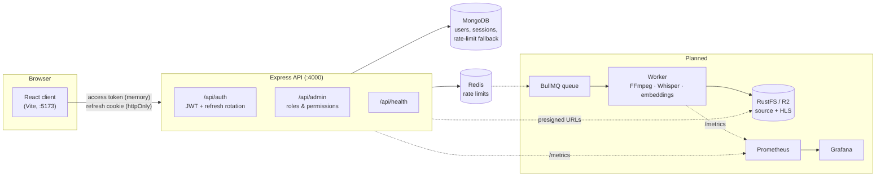
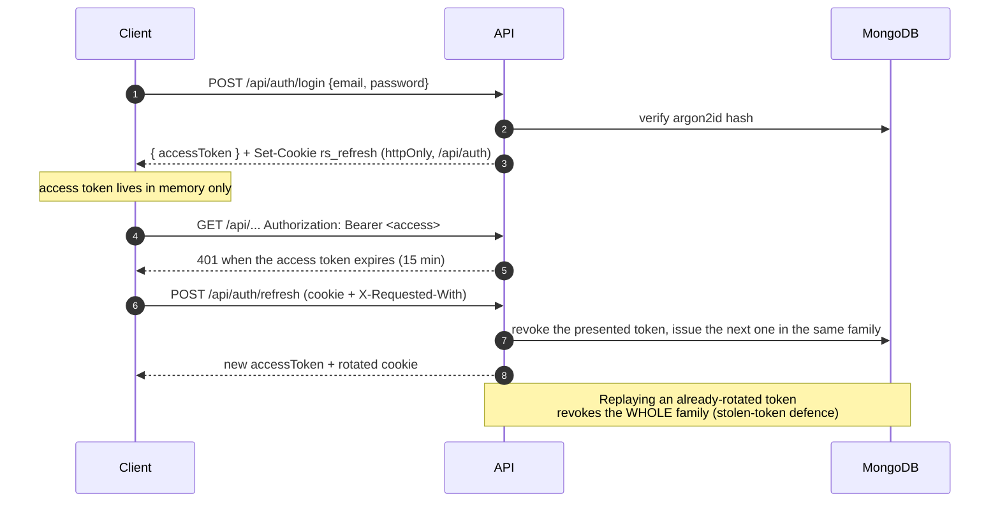

<div align="center">


### Ask any video. Jump straight to the answer.

A long-form video platform built with the MERN stack and TypeScript. It has adaptive HLS streaming, hardened JWT auth with refresh-token rotation, and **Ask the Video**: ask a question about a lecture or talk and get an answer that cites the exact second it was said.


</div>

---

## Contents
- [Features](#features)
- [Tech stack](#tech-stack)
- [Architecture](#architecture)
- [Auth flow](#auth-flow)
- [Getting started](#getting-started)
- [Local infrastructure (Docker)](#local-infrastructure-docker)
- [Environment variables](#environment-variables)
- [Scripts](#scripts)
- [API](#api)
- [Project layout](#project-layout)
- [Testing](#testing)
- [Roadmap](#roadmap)

---

## Features

### Built
- **JWT auth with refresh-token rotation:**
  - short-lived access token, kept in memory on the client
  - refresh token in an `httpOnly` cookie scoped to `/api/auth`
  - **reuse detection**: replaying a token that has already been rotated revokes the whole session family
- **Session management:** list every signed-in device, sign one out, or sign out everywhere.
- **Roles and permissions:** `user`, `moderator` and `admin`, with one permission map shared by the client and the server (`shared/src/permissions.ts`).
- **Rate limiting:**
  - per-IP and per-email limits on login, register, refresh and the username check
  - backed by **Redis**, with an automatic **MongoDB fallback** if Redis is down
- **Hardening:**
  - argon2id password hashing
  - Helmet security headers
  - a CSRF header check on cookie-authenticated routes
  - constant-time login (a dummy hash is checked when the user doesn't exist)
  - 100 KB JSON body limit
- **Three-step signup:**
  - **Account:** email, password with a strength meter, confirm password.
  - **Profile:** name, a unique `@username` with a live availability check, date of birth (13 or older).
  - **Interests:** pick topics and accept the terms.
  - Every rule is validated by the same zod schema on the client and the API.
- **Client UI:**
  - a cinematic home page with a featured "stage" and shelves
  - Explore, Subscriptions, History, Watch later, Liked and Library pages, plus channel pages
  - a ⌘K search / ask palette
  - a floating glass sidebar on desktop and a drawer on mobile
  - light and dark themes, responsive from 390px up
- **Watch page:**
  - a player with a console holding **Ask this video**, **Chapters** and **Transcript** tabs
  - clickable timestamp chips
- **Health endpoint** reporting MongoDB and Redis status.

> The video catalogue, transcripts and Ask answers in the UI currently come from a typed placeholder data layer (`client/src/data/`). That layer gets swapped for the real API in the phases below.

### In progress / planned
- Direct-to-storage chunked uploads (S3 multipart, presigned URLs)
- **BullMQ + FFmpeg** worker: transcode to a 360p/720p/1080p HLS ladder plus a thumbnail
- **Groq Whisper** transcription, then embeddings, then **RAG with timestamp citations**
- **Prometheus + Grafana** monitoring with a provisioned dashboard
- GitHub Actions CI and a production deploy

See the [Roadmap](#roadmap) for details.

---

## Tech stack

| Layer | Tools |
|---|---|
| **Client** | React 19, Vite, TypeScript, Tailwind CSS v4, shadcn/ui (Radix), Motion, react-hook-form + zod, sonner, cmdk |
| **Server** | Node.js ≥ 24, Express 5, Mongoose, zod, argon2, jsonwebtoken, Helmet, express-rate-limit, pino |
| **Shared** | `@reelstack/shared`: zod schemas, DTO types, the permission map (one source of truth for both sides) |
| **Database** | MongoDB 8 |
| **Cache / limits / queue** | Redis 7 via ioredis (rate limits today; the BullMQ job queue next) |
| **Object storage** | RustFS locally (S3-compatible), Cloudflare R2 in production |
| **Media** *(planned)* | FFmpeg → adaptive HLS, played with hls.js |
| **AI** *(planned)* | Groq Whisper (transcripts), local bge-small embeddings, Groq LLM for answers |
| **Monitoring** *(planned)* | prom-client → Prometheus → Grafana |
| **Testing** | Vitest, Supertest, mongodb-memory-server |
| **Tooling** | npm workspaces, Docker Compose, oxlint |

---

## Architecture



Solid lines are running today. Dotted lines and the **Planned** box are the next phases.

---

## Auth flow



- Concurrent refreshes are de-duplicated on the client, so the app never races itself into a reuse detection.
- `tokenVersion` on the user lets *log out everywhere* and role changes invalidate existing access tokens.

---

## Getting started

**Prerequisites:** Node.js ≥ 24, npm, and Docker (with Compose v2).

```bash
# 1. Install all workspaces
npm install

# 2. Configure the environment
cp .env.example .env
#    then set JWT_ACCESS_SECRET, e.g.:
node -e "console.log(require('crypto').randomBytes(48).toString('base64url'))"

# 3. Start MongoDB, Redis, RustFS and mongo-express (waits for the healthchecks)
npm run infra:up

# 4. Run shared (watch), the API and the client together
npm run dev
```

| URL | What |
|---|---|
| http://localhost:5173 | The app |
| http://localhost:4000/api/health | API health (`mongo` / `redis` status) |
| http://localhost:8081 | mongo-express (database browser) |
| http://localhost:9001/rustfs/console/ | RustFS console (object storage) |

**Make yourself an admin** (after you've registered in the app):

```bash
npm run user:role -- you@example.com admin     # user | moderator | admin
```

---

## Local infrastructure (Docker)

Everything runs from `docker-compose.yml`. All ports bind to `127.0.0.1` only, and data lives in named volumes, so it survives `infra:down`.

| Service | Image | Port(s) | Purpose |
|---|---|---|---|
| **mongo** | `mongo:8` | 27017 | Main database: users, refresh-token families, the rate-limit fallback |
| **mongo-express** | `mongo-express` | 8081 | Web UI for the database (basic auth from `.env`) |
| **redis** | `redis:7-alpine` | 6379 | Rate-limit store; the BullMQ queue next. Runs AOF persistence with `noeviction`, so queued jobs are never dropped |
| **rustfs** | `rustfs/rustfs` | 9000 (S3), 9001 (console) | S3-compatible object storage, standing in for Cloudflare R2 |
| **storage-init** | `rustfs/rustfs` | none | One-shot job that creates the bucket with a SigV4-signed `PUT` (no extra CLI image) |

```bash
npm run infra:up      # start + wait for the healthchecks
npm run infra:down    # stop (volumes are kept)
docker compose logs -f redis
docker compose down -v   # ⚠ also deletes all local data
```

> **Why RustFS and not MinIO?** MinIO stopped publishing free container images. RustFS is Apache-2.0 and speaks the same S3 API, so the code is identical against R2 in production.

**Redis is optional in development.** If it's unreachable, the API logs a warning once, `/api/health` reports `redis: "down"`, and rate limiting falls back to MongoDB for each call.

### Monitoring stack *(planned: Phase 6)*

A separate `monitoring/docker-compose.yml` will run:

| Service | Port | Purpose |
|---|---|---|
| **Prometheus** | 9090 | Scrapes `/metrics` from the API and the worker |
| **Grafana** | 3000 | A provisioned datasource plus a dashboard committed under `monitoring/grafana/`, so it works with no clicking |

The dashboard will show request rate, latency (p95) and errors by route; auth events (logins, refreshes, reuse detections, rate-limit hits); BullMQ queue depth and job duration and failures for transcode, transcribe and embed; and Ask latency with LLM token usage. Load is generated with **k6**.

---

## Environment variables

From `.env.example`. Never commit `.env`.

| Variable | Default | Notes |
|---|---|---|
| `NODE_ENV` | `development` | |
| `PORT` | `4000` | API port |
| `APP_URL` | `http://localhost:5173` | Client origin |
| `LOG_LEVEL` | *(empty → info)* | pino level |
| `MONGO_URI` | `mongodb://localhost:27017/reelstack` | |
| `REDIS_URL` | `redis://localhost:6379` | Leave empty to disable Redis |
| `JWT_ACCESS_SECRET` | **required** | 48+ random bytes |
| `ACCESS_TOKEN_TTL_SEC` | `900` | 15 minutes |
| `REFRESH_TOKEN_TTL_DAYS` | `7` | Also the "stay signed in" period |
| `S3_ENDPOINT` | `http://localhost:9000` | RustFS locally, the R2 endpoint in prod |
| `S3_REGION` | `us-east-1` | |
| `S3_BUCKET` | `reelstack` | Created by `storage-init` |
| `S3_ACCESS_KEY_ID` / `S3_SECRET_ACCESS_KEY` | `rustfsadmin` | Also the RustFS console login |
| `GROQ_API_KEY` | *(empty)* | Whisper and the LLM for Ask the Video (planned) |
| `MONGO_EXPRESS_USER` / `MONGO_EXPRESS_PASSWORD` | `admin` / `reelstack` | mongo-express basic auth |

---

## Scripts

Run these from the repo root.

| Command | What it does |
|---|---|
| `npm run dev` | Build `shared`, then run shared (watch), the API (`tsx watch`) and the client (Vite) together |
| `npm run build` | Build shared, then server, then client |
| `npm test` | Server tests, then client tests |
| `npm run typecheck` | Type-check shared and server |
| `npm run lint` | oxlint on the client |
| `npm run infra:up` / `infra:down` | Start / stop the Docker services |
| `npm run user:role -- <email> <role>` | Change a user's role from the CLI |

---

## API

All routes are under `/api`. Errors use one shape, `{ message, errors? }`; validation failures are `422` with `errors` keyed by field.

| Method | Route | Auth | Description |
|---|---|---|---|
| `GET` | `/health` | none | Uptime and MongoDB / Redis status |
| `POST` | `/auth/register` | none | Create an account. 5 per hour per IP |
| `GET` | `/auth/username-available?username=` | none | Live `@handle` check. 60 per hour per IP |
| `POST` | `/auth/login` | none | 5 failed attempts per minute per email + IP |
| `POST` | `/auth/refresh` | cookie + CSRF header | Rotate the refresh token, get a new access token |
| `POST` | `/auth/logout` | cookie + CSRF header | End this session |
| `POST` | `/auth/logout-all` | Bearer | End every session |
| `GET` | `/auth/me` | Bearer | The current user |
| `GET` | `/auth/sessions` | Bearer | Signed-in devices |
| `DELETE` | `/auth/sessions/:familyId` | Bearer | Sign one device out |
| `PATCH` | `/admin/users/:id/role` | Bearer + `user:set-role` | Change a role (admin only) |

Username availability is public on purpose (handles are public). There is deliberately **no** email availability endpoint, to avoid account enumeration.

---

## Project layout

```
reelstack/
├── shared/                 @reelstack/shared: zod schemas, DTOs, permissions
│   └── src/  auth.ts · permissions.ts · video.ts · health.ts · errors.ts
├── server/                 Express API
│   ├── src/
│   │   ├── auth/           tokens, refresh rotation, cookies, argon2
│   │   ├── middleware/     requireAuth, requirePermission, CSRF, rate limits, validation
│   │   ├── models/         User, RefreshToken, RateLimit
│   │   ├── routes/         auth, admin, health
│   │   ├── lib/            logger (pino), redis, rate-limit store
│   │   └── cli/            setRole
│   └── test/               Vitest + Supertest (in-memory MongoDB)
├── client/                 React + Vite
│   └── src/
│       ├── pages/          Home, Watch, Explore, Library, Login, Register, …
│       ├── components/     shell/ · media/ · watch/ · auth/ · ui/ (shadcn)
│       ├── auth/           AuthProvider, guards, register-form schema
│       ├── api/            axios client with refresh handling
│       ├── data/           placeholder catalogue (replaced by the API later)
│       └── hooks/          library store, appearance, debounce
└── docker-compose.yml      mongo · mongo-express · redis · rustfs · storage-init
```

---

## Testing

```bash
npm test                       # everything
npm run test -w server         # API: auth, rotation, reuse detection, roles, register rules
npm run test -w client         # client: refresh handling, forms, password scoring, library store
```

- Server tests run against **mongodb-memory-server**, so they don't need Docker.
- They cover:
  - register validation: age 13+, terms, interests, password rules, duplicate email and username
  - refresh rotation and reuse detection
  - session revocation
  - rate limits
  - role permissions

---

## Roadmap

| Phase | Scope | Status |
|---|---|---|
| 0 | Monorepo, Docker infra | ✅ Done |
| 1 | JWT auth, refresh rotation, sessions, roles, rate limits, 3-step signup | ✅ Done |
| — | Client UI: shell, home, watch, library, auth screens | ✅ Done (placeholder data) |
| 2 | Upload pipeline: S3 multipart direct to RustFS / R2 with presigned URLs | ⏳ Next |
| 3 | **BullMQ worker:** FFmpeg → 360p/720p/1080p HLS plus a thumbnail, with retries and backoff | 🗓 Planned |
| 4 | Player (hls.js), comments, likes, subscriptions on the real API | 🗓 Planned |
| 5 | **Ask the Video:** Whisper transcripts → embeddings → hybrid retrieval → cited answers; moment search | 🗓 Planned |
| 6 | **Prometheus + Grafana**, k6 load tests, GitHub Actions CI, deploy (API + worker on Render/Fly, client on Vercel, R2, Atlas, managed Redis) | 🗓 Planned |

